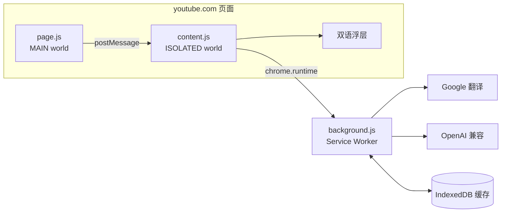

# yt-bilingual

> 给 YouTube 加一层「原文 + 译文」的双语字幕。装好即用，默认走 Google 免费翻译，也可以换成自己的 OpenAI 兼容接口。

<p>
  
  
  
  
  
</p>

**简体中文** · [English summary](#english-summary)

---

## 这个项目是什么

一个本地加载的 Chrome / Edge 扩展（Manifest V3），只做一件事：

> 在 `youtube.com/watch` 页面上，把视频的 CC 字幕实时翻译成你的语言，以「原文一行 + 译文一行」的形式叠在播放器底部。

- **不修改 YouTube 页面结构**，字幕是一层独立浮层，可拖动、全屏跟随。
- **不抓视频、不下载音频**，只读 YouTube 已经提供的字幕轨。
- **不上传任何数据**，翻译请求只发往你选择的翻译服务。

**不是什么**：不是视频下载器，不是语音转写工具，也不支持没有 CC 轨的视频（V1 明确不做 ASR）。

---

## 效果

```
┌──────────────────────────────────────────────────────────┐
│                                                          │
│                 （YouTube 视频画面）                       │
│                                                          │
│        cheer going up in St. Peter's Square as           │
│              圣彼得广场上人群欢呼                           │
│                                                          │
└──────────────────────────────────────────────────────────┘
```

- 播放时自动切换；译文按句子预取，正常播放基本感觉不到等待。
- 拖动词幕可调整位置，刷新后保留。
- `Alt + B` 开关；popup 里能看到视频 ID、翻译进度和状态。

---

## 特性

**字幕**

- 直接读 YouTube 的 `captionTracks`（人工字幕、自动字幕都支持）
- 自动字幕的碎片会按停顿和标点**合并成句**再翻译，避免逐条硬译
- 服务端 POT 校验导致 timedtext 返回空时，自动打开 CC 并**复用播放器自己请求到的字幕正文**（带完整时间轴）
- 再不行就降级为「原生字幕 + 逐句翻译」，保证仍可用
- 隐藏 YouTube 原生字幕，避免双语重复；关闭扩展立即恢复
- 字幕文字自带描边，亮画面/半透明底也清晰

**翻译**

- 默认 Google 免费接口（无需 Key）
- 可切换任意 OpenAI 兼容 `/chat/completions`：OpenAI、DeepSeek、Ollama、自建网关
- 按播放进度预取（默认提前 60 秒），拖动进度条会重排优先级
- 同一句只请求一次：内存去重 + IndexedDB 跨会话缓存
- 失败退避重试；单条失败不影响整批，原文照常显示
- `Mock` 模式：不联网、不花钱，用于验证「字幕抓取 + 渲染」链路

**工程**

- Manifest V3，内容脚本分 MAIN / ISOLATED 两个世界，职责清晰
- 无框架、无运行时依赖，esbuild 单文件打包，`dist/` 约 120KB
- `node:test` 单元测试 31 个用例，GitHub Actions 自动跑

---

## 快速开始

### 1. 构建

```bash
git clone <你的仓库地址> yt-bilingual
cd yt-bilingual

npm install     # 只用于构建，扩展运行时不依赖 node_modules
npm run build   # 产物在 dist/
```

### 2. 加载扩展

1. Chrome / Edge 打开 `chrome://extensions`（Edge 是 `edge://extensions`）。
2. 右上角打开 **开发者模式**。
3. 点 **加载已解压的扩展程序**，选择仓库里的 `dist/` 目录。
4. 建议把扩展图标固定到工具栏。

### 3. 打开视频

打开任意带 CC 字幕的视频（TED、新闻、公开课都行），1~3 秒内底部会出现双语字幕。

> 装好后默认就是 Google 免费接口，**不需要任何配置**。
> 如果页面在安装前就开着，记得刷新一次。

---

## 配置

点扩展图标 → **打开设置**。

### 默认：Google 免费接口

- 无需 Key，直接可用。
- 非官方端点，连续翻译久了可能触发 `HTTP 429`，等几分钟或换接口即可。

### 可选：OpenAI 兼容（质量更好）

接口类型选 **OpenAI 兼容**，然后填：

| 服务 | Base URL | 模型 |
| --- | --- | --- |
| OpenAI | `https://api.openai.com/v1` | `gpt-4o-mini` |
| DeepSeek | `https://api.deepseek.com/v1` | `deepseek-chat` |
| Ollama（本地） | `http://localhost:11434/v1` | `qwen2.5:7b` |
| 任意兼容网关 | 你的地址（以 `/v1` 结尾） | 你的模型名 |

填完点 **测试连接**，成功会显示耗时和一条示例译文。保存时会弹窗申请该 API 域名的访问权限。

### 其他设置

| 设置 | 说明 |
| --- | --- |
| 目标语言 | 简中 / 繁中 / 日 / 韩 / 英 / 西 / 法 / 德 / 俄 |
| 单批最大字符 | 一次请求翻译多少内容，越大越省请求、越费 token |
| 预取窗口 | 提前翻译多少秒的字幕，默认 60 |
| 并发请求数 | 默认 2 |
| 显示原文行 | 关掉就只显示译文 |
| 隐藏原生字幕 | 默认开 |
| 字号 / 颜色 / 背景不透明度 / 距底部 | 字幕外观，改完即时生效 |

---

## 工作原理



**关键设计**

1. **MAIN world 只做一件内容脚本做不到的事**：读 `#movie_player.getPlayerResponse()` 拿字幕轨元数据。
2. **timedtext 有 POT 校验**：第三方直接请求会拿到 `200 + 空 body`。所以在 MAIN world hook `fetch` / `XMLHttpRequest`，把播放器自己（带 pot）请求到的字幕正文抄一份，再解析。
3. **句子是翻译单位**：`cue → Segment` 合并后按时间轴切批，而不是逐条翻。
4. **预取而不是实时**：`currentTime + prefetchSeconds` 内的段落提前翻译，播放时直接取缓存。
5. **缓存键与视频无关**：`sha1(provider|model|target|text)`，同一句话在任何视频里都命中。
6. **浮层挂载在 `.html5-video-player` 内**：全屏、剧场模式自动跟随；用 CSS 变量控制外观。

更细的取舍和踩坑记录见 [docs/ANALYSIS.md](docs/ANALYSIS.md)。

---

## 项目结构

```
src/
  page/main.ts           页面主世界：字幕轨元数据 + timedtext 抓包 + 自动开 CC
  content/index.ts       编排：状态机、加载、开关、SPA 切换、诊断属性
  content/captions.ts    拉取并解析 json3 / timedtext XML / VTT
  content/segmenter.ts   cue → 句级 Segment、二分查找、切批
  content/overlay.ts     双语浮层 + 拖动 + 全屏
  content/queue.ts       预取窗口、并发、退避重试
  content/dom-fallback.ts  最后一道兜底：原生字幕逐句翻译
  background/sw.ts       消息路由 + 缓存 + 快捷键
  background/provider.ts Google / OpenAI 兼容调用与错误分类
  background/cache.ts    IndexedDB（LRU 裁剪）
  options/ popup/        设置页与弹窗
test/                    解析、分段、provider、Google 接口单测
docs/ANALYSIS.md         沉浸式翻译拆解（架构参考）
docs/TESTING.md          手工验收、故障注入、调试入口
```

---

## 开发与测试

```bash
npm run typecheck   # TypeScript 类型检查
npm test            # node:test，31 个用例
npm run build       # 产物在 dist/
npm run watch       # esbuild watch；改完在 chrome://extensions 点「重新加载」
npm run verify      # 上面三步一次跑完
```

构建用 esbuild CLI（`build.mjs`），不引入框架，UI 是原生 DOM。

手工验收清单、故障注入（401 / 断网 / 强制 timedtext 失败）、调试入口见 [docs/TESTING.md](docs/TESTING.md)。

页面控制台可以直接看状态：

```js
document.documentElement.dataset.ytbPhase     // waiting / loading / translating / ready / fallback / error
document.documentElement.dataset.ytbSegments  // 字幕段总数
document.documentElement.dataset.ytbDone      // 已翻译段数
document.documentElement.dataset.ytbCaptured  // 是否抓到播放器的 timedtext
```

---

## 已知限制

- 只支持 `youtube.com/watch`：Shorts、站外嵌入、移动端未适配
- 直播流没有可下载字幕轨
- 没有语音识别：视频必须有 CC 字幕（人工或自动）
- Google 用的是非官方免费端点，可能被限流，稳定性不作为承诺
- 不做术语库、双语导出、整片预翻译

---

## 隐私与合规

- 字幕原文会发送到你选择的翻译服务：默认 **Google 翻译**；切到 OpenAI 兼容后只发往你填写的 Base URL。
- 扩展本身不收集、不上传任何数据；没有埋点、没有远程配置。
- API Key 以明文存在 `chrome.storage.local`，仅本机可读；共用电脑请留意。
- 本项目只读取 YouTube 已公开提供的字幕轨，不下载视频/音频。请遵守 YouTube 服务条款与当地法律，仅作个人学习使用。

---

## 常见问题

<details>
<summary>浮层不出现，popup 显示「等待 YouTube 视频」</summary>

确认当前是 `/watch` 页面；到 `chrome://extensions` 点「重新加载」，再刷新页面。
</details>

<details>
<summary>显示「该视频没有字幕」</summary>

播放器里没有 CC 轨。点齿轮 → 字幕/CC 确认有语言可选；没有就换一个视频。
</details>

<details>
<summary>显示「正在通过播放器读取…」</summary>

YouTube 的 timedtext 被 POT 校验挡住，扩展正在自动打开 CC 并读取播放器自己的字幕请求，等 2~5 秒。
</details>

<details>
<summary>显示「已自动打开 CC，使用原生字幕逐句翻译」</summary>

播放器请求也没抓到，已降级为逐句翻译；译文会出现在原生字幕上方，仍可正常使用。
</details>

<details>
<summary>字幕和背景“糊在一起”</summary>

到设置页把「背景不透明度」调到 0.85 左右；文字本身已带描边，调到 0 也能看清。
</details>

<details>
<summary>HTTP 401 / 404 / 429</summary>

- `401`：API Key 错误或模型未开通
- `404`：Base URL 少写/多写了 `/v1`
- `429`：Google 免费接口限流，等几分钟或改用 OpenAI 兼容
</details>

<details>
<summary>全屏后字幕消失</summary>

点一下播放器让 YouTube 重建容器；若仍复现，请提 issue 并附控制台 `[yt-bilingual]` 日志。
</details>

---

## 参与贡献

欢迎 issue / PR。提交前请确保 `npm run verify` 通过；改动涉及字幕选择器或时序时，请附上测试视频类型（人工字幕 / 自动字幕 / 有无广告）。

---

## 致谢

- 架构思路参考了 [沉浸式翻译](https://github.com/immersive-translate/immersive-translate)。该项目本身不开源，本仓库**没有复制它的代码**；拆解笔记见 [docs/ANALYSIS.md](docs/ANALYSIS.md)。
- 早期实现参考了其归档的开源版本 [old-immersive-translate](https://github.com/immersive-translate/old-immersive-translate)（MPL-2.0）的公开设计。

---

## License

[MIT](LICENSE) © 2026 cc-xx-load

---

## English summary

A local Manifest V3 extension that overlays bilingual subtitles (original + translated) on YouTube. It reads YouTube's caption tracks, merges ASR fragments into sentences, translates them with Google (free, default) or any OpenAI-compatible endpoint, and prefetches ahead of playback. No telemetry, no video downloading, no server. See [docs/ANALYSIS.md](docs/ANALYSIS.md) for design notes.
